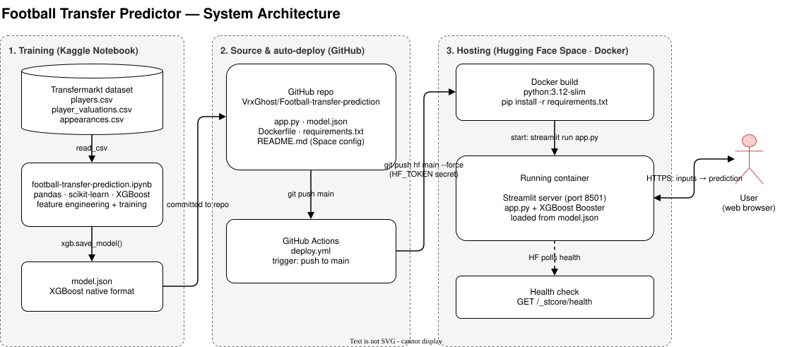
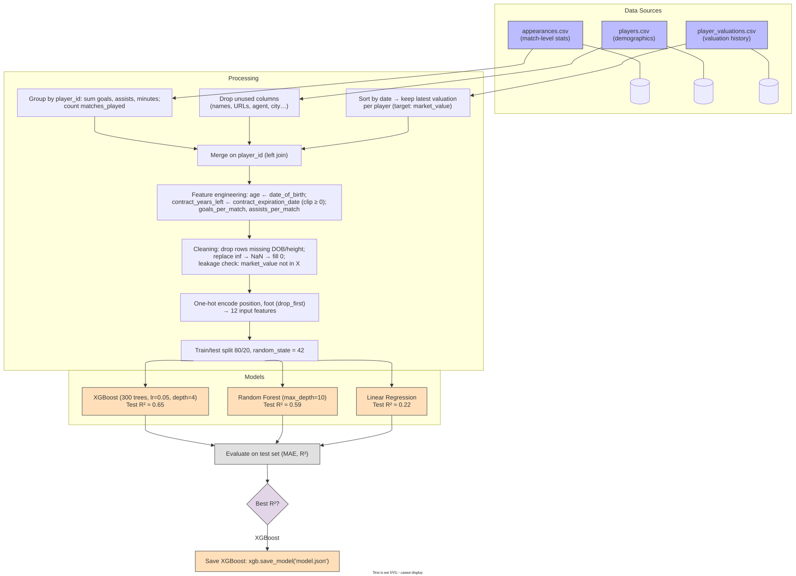
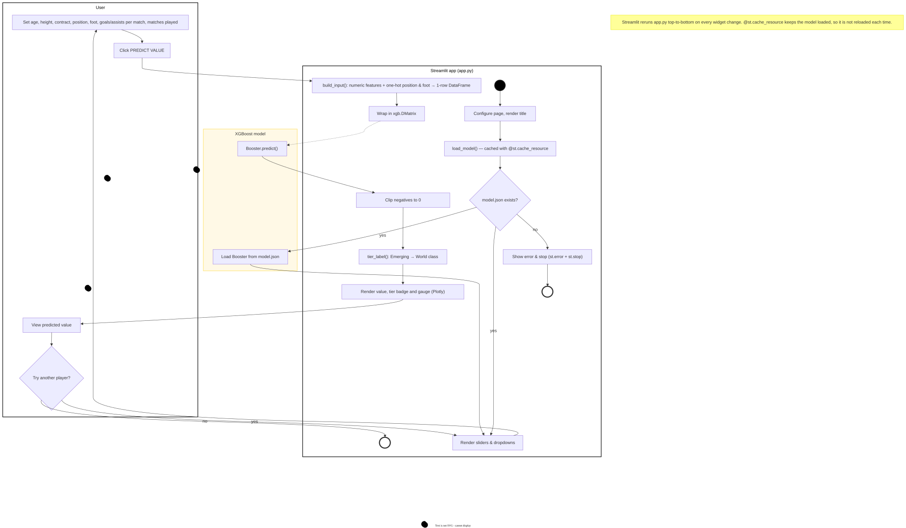

# ⚽ Football Transfer Value Prediction

An XGBoost model that estimates a football player's market value (in €) from age, height, position, preferred foot, contract length and scoring record, trained on Transfermarkt data and served as a Streamlit app on Hugging Face Spaces.

[](https://huggingface.co/spaces/VrxGhost/football-transfer-predictor) [](https://python.org) [](https://xgboost.readthedocs.io) [](https://streamlit.io) [](https://www.kaggle.com/code/duttaarya/football-transfer-prediction)


*Example with the app's default inputs: a 24-year-old, 170 cm, right-footed attacker with 2 contract years left, 0.25 goals and 0.12 assists per match, and 120 matches played. Estimated value: € 7.5M (Mid-Market).*

---

## ✨ Highlights

- **Test R² 0.65, MAE €1.10M** with XGBoost on 7,821 held-out players, up from R² 0.02 (MAE €2.07M) for a linear baseline on age and height
- Caught a target-leakage bug that produced a fake R² of 1.0
- Dockerized Streamlit app on Hugging Face Spaces, deployed by GitHub Actions on every push to `main`

---

## 🔴 Live Demo

👉 **[Try it here → huggingface.co/spaces/VrxGhost/football-transfer-predictor](https://huggingface.co/spaces/VrxGhost/football-transfer-predictor)**

Set the player's attributes and click **PREDICT VALUE**. The app shows the estimated value, a tier label (Emerging, Mid-Market, High Value, Elite, World class) and a gauge whose colour bands match those tiers.

The Space goes to sleep when nobody has used it for a while, so the first load can take a minute.

---

## 🎯 Problem Statement

Clubs spend billions on transfers every year, and a player's market value is a starting point for those negotiations. This project builds a regression model that estimates a player's Transfermarkt market value from a handful of attributes and serves it as an interactive web app.

---

## 🏛️ System Architecture



The model is trained in a Kaggle notebook and saved as `model.json`. Every push to `main` runs a GitHub Actions workflow that pushes the repo to the Hugging Face Space, where Hugging Face builds the Docker image and runs the Streamlit app on port 8501. The workflow only deploys; it doesn't run tests yet.

---

## 📊 Dataset

**Source:** [Football Data from Transfermarkt](https://www.kaggle.com/datasets/davidcariboo/player-scores) on Kaggle

| File | What this project uses |
| --- | --- |
| `player_valuations.csv` | Market value history. Each player's latest valuation is the target |
| `players.csv` | Date of birth, height, position, preferred foot, contract expiry date |
| `appearances.csv` | Match-by-match goals and assists, summed per player |

The deployed model comes from the May 2026 training run: **640,176 valuation records covering 41,334 players**. Dropping players with no date of birth or height leaves **39,101 players**, split 80/20 at random (`random_state=42`) into 31,280 training and 7,821 test players.

The dataset is updated regularly (it had 448,965 valuation records when this project started in February 2026), so re-running the notebook gives slightly different numbers.

---

## 🔧 Features

| Feature | How it's built |
| --- | --- |
| `age` | Whole years from date of birth to the date the notebook ran |
| `height_in_cm` | From `players.csv` |
| `contract_years_left` | Years from the date the notebook ran to contract expiry. Expired contracts count as 0, and so do missing expiry dates |
| `goals_per_match` | Goals ÷ appearances in `appearances.csv` (0 for players with no appearances) |
| `assists_per_match` | Assists ÷ appearances (0 for players with no appearances) |
| `matches_played` | Number of appearances in `appearances.csv` |
| `position_*` | One-hot: Defender, Goalkeeper, Midfield, Missing (Attack is the baseline) |
| `foot_*` | One-hot: left, right (both feet is the baseline) |

**Target:** `market_value_in_eur` from each player's most recent valuation.

---

## 📈 Model Results

All models use the same 80/20 split.

| Model | Features | Test R² | Test MAE |
| --- | --- | --- | --- |
| Linear Regression | age + height | 0.02 | €2.07M |
| Linear Regression | all 12 | 0.22 | €2.12M |
| Random Forest (100 trees) | all 12 | 0.61 | €1.15M |
| Random Forest (200 trees, max depth 10) | all 12 | 0.59 | not recorded |
| **XGBoost (300 trees, max depth 4, learning rate 0.05)** | **all 12** | **0.65** | **€1.10M** |

XGBoost was selected as the final model.

---

## ⚠️ Known Limitations

- **Features and target come from different dates.** The target is each player's latest valuation, which for retired players can be years old, but age and contract length are measured from the date the notebook ran. For example, Miroslav Klose's latest valuation is from January 2016, yet his age is computed as 47. Planned fix: measure features at each valuation date and train only on recent valuations.
- **Predictions are very sensitive to contract length.** For the app's default player, 2 years left gives €7.5M and 5 years gives €37.3M. Part of this is probably the date problem above: retired players have no contract, so "years left" partly encodes "still playing". The app caps contract length at 5 years, FIFA's standard maximum.
- **Career stats only count matches in `appearances.csv`**, so players with many matches outside the dataset look less experienced than they are.
- **No uncertainty estimate.** The app shows a single number. Real prediction intervals (quantile regression) are on the roadmap.

---

## 🏗️ ML Pipeline



```
Data loading        → players.csv + player_valuations.csv + appearances.csv
Target              → latest valuation per player
Merging             → join on player_id
Feature engineering → age, contract_years_left, goals_per_match, assists_per_match, matches_played
Cleaning            → drop players missing date of birth or height; drop market-value columns that leak the target
Encoding            → one-hot encode position and foot (12 features in total)
Training            → Linear Regression → Random Forest → XGBoost on an 80/20 split
Evaluation          → R² and MAE on the test set
Serialization       → xgb.save_model("model.json"), XGBoost's native JSON format
Deployment          → GitHub Actions → Hugging Face Spaces (Docker) → Streamlit
```

---

## ⚙️ How the App Works

**Activity diagram:** what happens from opening the app to seeing a prediction.



Streamlit reruns `app.py` from top to bottom on every widget change, and `@st.cache_resource` keeps the model in memory, so `model.json` is read only once. When you click **PREDICT VALUE**, the app builds a one-row DataFrame in the model's feature order, runs `Booster.predict()`, clips negative predictions to 0 and shows the result.

---

## 🧠 Key Learnings

**A leak looks like a perfect score.** Accidentally including `market_value` as a feature gave R² = 1.0, which was perfect and completely fake. After removing it (and the market-value columns in `players.csv`), the notebook now checks that the target isn't among the features.

**Model choice mattered more than adding features.** Going from 2 features to 12 took linear regression from R² 0.02 to 0.22, while switching to tree models reached 0.61–0.65. Value is strongly non-linear in age: for the app's default player, the final model predicts €31.1M at 19, €5.3M at 25 and €589K at 31. A single linear coefficient can't fit that shape.

**R² on raw euros is dominated by the most expensive players.** Adding features raised linear regression's R² from 0.02 to 0.22, yet its MAE got slightly worse (€2.07M → €2.12M). Training on log(value) is on the roadmap.

**A smaller train/test gap isn't automatically better.** Limiting tree depth cut the Random Forest's train/test R² gap from 0.33 to 0.15, but test R² fell from 0.61 to 0.59.

**Model files are code too.** The original pickle file triggered a Hugging Face security warning, because loading a pickle can run arbitrary code. Moving to XGBoost's native JSON format fixed that. JSON models are only guaranteed to load in the same or a newer XGBoost version, so the app pins the version used for training.

---

## 🗂️ Project Structure

```
Football-transfer-prediction/
│
├── app.py                              # Streamlit web app
├── model.json                          # Trained XGBoost model (native JSON format)
├── football-transfer-prediction.ipynb  # Training notebook (synced from Kaggle)
├── requirements.txt                    # App dependencies
├── requirements-train.txt              # Extra libraries to run the notebook locally
├── Dockerfile                          # Container build for Hugging Face Spaces
├── docs/
│   └── diagrams/
│       ├── 1-system-architecture.svg   # Kaggle → GitHub → GitHub Actions → HF Spaces
│       ├── 2-ml-pipeline.svg           # Data loading → features → model comparison
│       └── 3-activity-diagram.svg      # App flow from inputs to prediction
├── .github/
│   └── workflows/
│       └── deploy.yml                  # Pushes main to the Hugging Face Space
└── README.md                           # This file; its header is the Space config
```

---

## 🚀 Run Locally

With Python 3.12:

```bash
git clone https://github.com/VrxGhost/Football-transfer-prediction.git
cd Football-transfer-prediction
python -m venv .venv
source .venv/bin/activate        # Windows: .venv\Scripts\activate
pip install -r requirements.txt
streamlit run app.py
```

Or with Docker:

```bash
docker build -t football-predictor .
docker run -p 8501:8501 football-predictor
```

Then open http://localhost:8501.

To re-run the training notebook on your own computer instead of Kaggle, install `requirements-train.txt` instead. The comments at the top of that file explain how, including where to get the dataset.

---

## 🛠️ Tech Stack

| Layer | Tools |
| --- | --- |
| Training | Python 3.12 on Kaggle · pandas, NumPy, scikit-learn, XGBoost 3.1.3 |
| App | Streamlit, Plotly |
| Deployment | Docker, Hugging Face Spaces |
| Automation | GitHub Actions (deploys on every push to `main`) |

---

## 🗺️ Roadmap

- [x] Data pipeline and feature engineering
- [x] Model comparison (Linear Regression → Random Forest → XGBoost)
- [x] Streamlit app on Hugging Face Spaces with Docker
- [x] Pickle → XGBoost native JSON
- [x] Auto-deploy with GitHub Actions
- [ ] Measure features at each valuation date and train on recent valuations only
- [ ] Train on log(value); report MAE and median % error
- [ ] Prediction intervals with quantile regression
- [ ] Move training code from the notebook into a script
- [ ] Tests and linting in GitHub Actions before deploying

---

## 👤 Author

**Arya Dutta**, B.Tech CSE student at IEM Kolkata, building AI and backend systems

[](https://www.kaggle.com/code/duttaarya/football-transfer-prediction) [](https://huggingface.co/VrxGhost) [](https://www.linkedin.com/in/arya-dutta-9a4619317)
